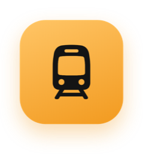
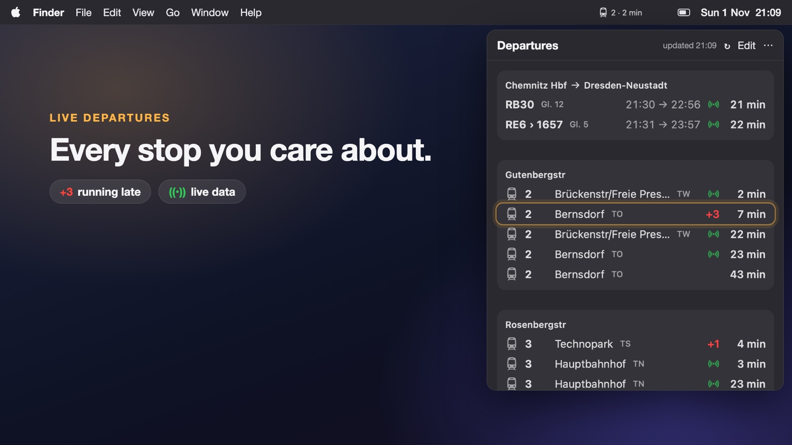
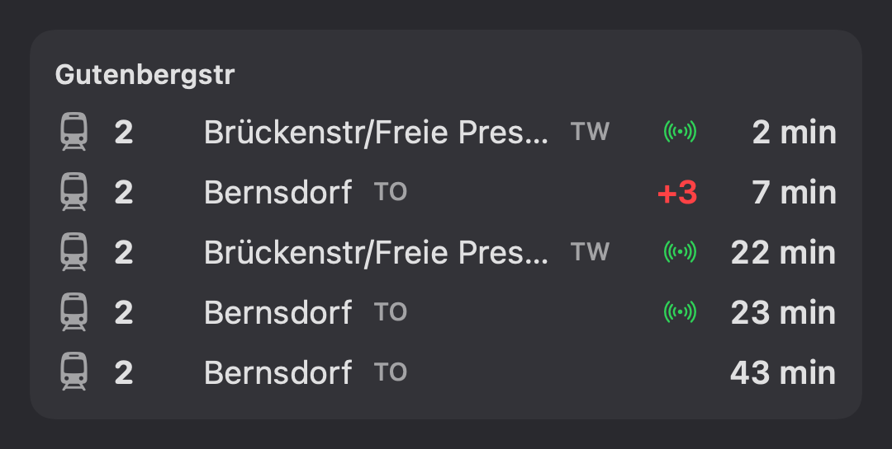
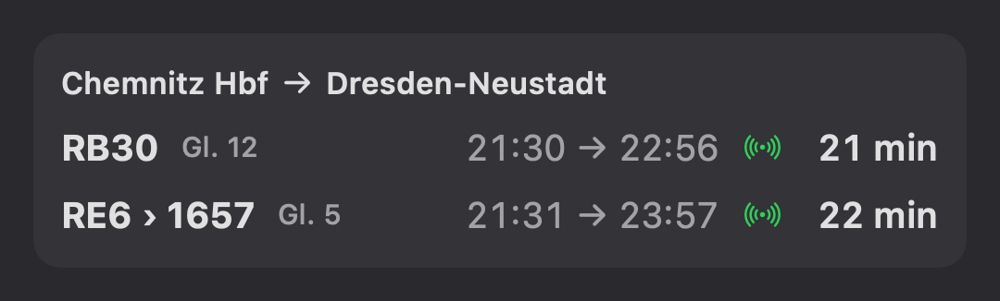
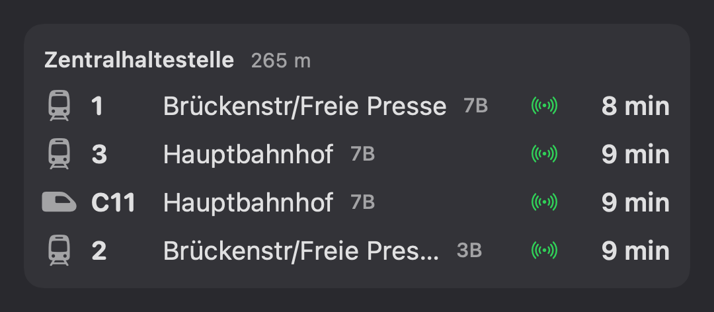

<div align="center">



# TramBar

**Your next tram, right in your Mac's menu bar or your Windows and Linux system tray.**

Live tram, bus and train departures for Chemnitz, the whole VMS area and the rest of Germany.

[](#requirements)
[](Sources/TramBar)
[](#install)
[](LICENSE)

<br>

<a href="https://youtu.be/An4sSG2jipA"></a>

**[▶ Watch the 35-second trailer on YouTube](https://youtu.be/An4sSG2jipA)**

</div>

<br>

## Why

Is your tram two minutes away, or did you just miss it? Normally you unlock your
phone, open an app and search for your stop. TramBar puts the answer where you
are already looking: the menu bar shows the next departure from your main stop,
for example .
Click it for the full picture.

## Features

<table>
<tr>
<td width="50%" valign="top">

### Your stops
The next departures from every stop you save, with **live delays**,
cancellations and platforms. A green signal means realtime data, a red `+3`
means the tram is running three minutes late.

</td>
<td width="50%"></td>
</tr>
<tr>
<td width="50%" valign="top">

### Your routes
Save a trip from A to B, like *Chemnitz Hbf → Dresden-Neustadt*, and see your
next connections with departure and arrival times, changes and platforms.

</td>
<td width="50%"></td>
</tr>
<tr>
<td width="50%" valign="top">

### Near you
Somewhere new? TramBar finds the stops closest to you, how far away they are,
and what leaves from them next.

</td>
<td width="50%"></td>
</tr>
</table>

Departures refresh every 30 seconds, and the countdowns in the panel tick every second.

## Install

### macOS

With [Homebrew](https://brew.sh):

```bash
brew install tanvieer/tap/trambar
```

Then start it, and have it start again at every login:

```bash
brew services start trambar
```

Homebrew builds TramBar on your Mac from this source code. That takes a minute
or two, and it needs Apple's Command Line Tools (`xcode-select --install`), which
Homebrew asks for if they are missing. Because the app is built on your own
machine, macOS opens it without any "unidentified developer" warning.

To update later:

```bash
brew upgrade trambar && brew services restart trambar
```

<details>
<summary><b>Without Homebrew</b></summary>

```bash
git clone https://github.com/tanvieer/trambar.git
cd trambar
./build.sh
open build/TramBar.app
```

</details>

### Windows

1. Open the [latest release](https://github.com/tanvieer/trambar/releases/latest)
   and download `TramBar_x.y.z_x64-setup.exe`.
2. Run it. Windows SmartScreen may say *"Windows protected your PC"*, because the
   installer is not signed: click **More info → Run anyway**.
3. TramBar starts in the notification area at the bottom right of the taskbar. If
   you don't see the tram icon, click the **^** arrow next to the clock, then drag
   the icon onto the taskbar so it stays visible.
4. Click the icon to open the panel. Windows trays cannot show text, so hover over
   the icon to see the next departure, for example *TramBar · 2 · 4 min*.

Windows 10 and 11 are supported. The installer adds Microsoft's WebView2 runtime
if it is missing. Prefer an MSI for managed PCs? Use `TramBar_x.y.z_x64_en-US.msi`.
To uninstall, use **Settings → Apps → TramBar**.

TramBar updates itself: it checks for a new release at start and every six
hours, installs it and restarts.

### Linux

Download the package for your distribution from the
[latest release](https://github.com/tanvieer/trambar/releases/latest):

**Ubuntu, Debian, Linux Mint**

```bash
sudo apt install ./TramBar_x.y.z_amd64.deb
```

**Fedora, openSUSE**

```bash
sudo dnf install ./TramBar-x.y.z-1.x86_64.rpm
```

**Any other distribution**

```bash
chmod +x TramBar_x.y.z_amd64.AppImage
./TramBar_x.y.z_amd64.AppImage
```

Then start **TramBar** from your app menu. Where the icon appears depends on the
desktop:

| Desktop | Where TramBar shows up |
|---|---|
| KDE Plasma, XFCE, Cinnamon, MATE, LXQt | The system tray in the panel, with the next departure as text where the panel supports it. |
| GNOME on Ubuntu | The top bar, top right. Ubuntu ships the AppIndicator extension that this needs. |
| GNOME on Fedora and others | Install the [AppIndicator extension](https://extensions.gnome.org/extension/615/appindicator-support/) first (`sudo dnf install gnome-shell-extension-appindicator`), then log out and in. |

The `.deb` and `.rpm` pull in the tray library (`libayatana-appindicator3`)
themselves. For the AppImage on a minimal system you may need to install it:
`sudo apt install libayatana-appindicator3-1`.

*Near you* uses GeoClue for location. If the section keeps saying *Finding stops
near you*, check that location services are on in your desktop's privacy
settings, or turn the section off under **Edit**.

**Updates.** The AppImage updates itself, like the Windows app. With the `.deb`
or `.rpm`, download the new package and install it the same way as above; it
replaces the old version.

<details>
<summary><b>Build it yourself (Windows or Linux)</b></summary>

You need [Rust](https://rustup.rs) and the
[Tauri prerequisites](https://v2.tauri.app/start/prerequisites/) for your system.

```bash
git clone https://github.com/tanvieer/trambar.git
cd trambar/desktop/src-tauri
cargo install tauri-cli --version "^2"
cargo tauri build
```

The installers end up in `desktop/src-tauri/target/release/bundle/`.

</details>

## Use

| | |
|---|---|
| **Add stops and routes** | Click **Edit**, then type at least three letters of a stop name. |
| **Pick the menu bar stop** | The stop at the top of the list is shown in the menu bar (or tray). Use the ↑ button to change it. |
| **Open at login** | On Windows and Linux, tick **Open at login** under **Edit**. |
| **Near you** | Allow location access when macOS asks. Turn the section off under **Edit** if you don't want it. |
| **Settings file** | macOS: `~/Library/Application Support/TramBar/settings.json`<br>Windows: `%APPDATA%\io.github.trambar\settings.json`<br>Linux: `~/.config/io.github.trambar/settings.json`<br>The format is the same everywhere, so you can copy it between machines. |

## Privacy

TramBar has no account, no analytics and no server of its own. It talks only to
the public EFA timetable services listed below. If you turn on *Near you*, your
coordinates are sent to the VMS service to look up the closest stops, and nowhere else.

## Data

TramBar uses public EFA timetable services. No account or API key is needed.

- **Stop search, Near you, and everything in Saxony:** the EFA service of the
  [Verkehrsverbund Mittelsachsen](https://www.vms.de) (VMS), hosted by the
  [Verkehrsverbund Oberelbe](https://www.vvo-online.de) (VVO). It knows stops all
  over Germany, with realtime data in Saxony.
- **North Rhine-Westphalia:** the EFA service of the
  [Verkehrsverbund Rhein-Ruhr](https://www.vrr.de) (VRR).
- **Bavaria:** the EFA service of [Bahnland Bayern](https://www.bahnland-bayern.de),
  run by the Bayerische Eisenbahngesellschaft (BEG).
- **Baden-Württemberg:** the EFA service of the
  [Nahverkehrsgesellschaft Baden-Württemberg](https://www.nvbw.de) (NVBW).

TramBar picks the service from the stop's id, which says which state the stop is
in. In other states you get timetable times from VMS, and realtime only where it
reaches that service. Realtime is shown wherever the operator provides it.
TramBar is not affiliated with any of these organisations or with Deutsche Bahn.

## Requirements

- macOS 14 Sonoma or later
- Windows 10 or 11 (64-bit)
- Linux x86_64 with WebKitGTK 4.1 (Ubuntu 22.04+, Debian 12+, Fedora 38+)


## License

[MIT](LICENSE)
